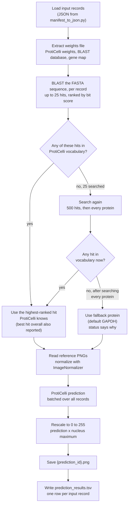

## Pipeline description

The pipeline has two stages:

1. **Protein identification.** The amino acid sequence is searched with BLAST against a local database of reviewed human UniProt (Swiss-Prot) entries. Hits are ranked by bit score, and the highest-ranked hit whose gene ProtiCelli knows is used, however weak; it is mapped from its UniProt accession to an Ensembl gene ID and HGNC symbol with a local gene map. No network access is used at runtime.
2. **Image prediction.** The three reference PNGs are normalized with ProtiCelli's own `ImageNormalizer`, then passed with the HGNC symbol to [ProtiCelli](https://github.com/CellProfiling/ProtiCelli), which generates the predicted image. The prediction is mapped back to 0 to 255 and saved as an 8-bit PNG.

ProtiCelli uses a learned embedding for each protein it was trained on, so it can only predict proteins in its vocabulary (12,809 entries in `proticelli/data/antibody_map.pkl` in the installed package). The protein search therefore takes the closest match ProtiCelli can predict, and reports the closest match overall alongside it for our own checks. No record is skipped: if no hit is usable, a fixed fallback protein is used (`--fallback_protein`, default GAPDH) and the status column says why, so every record gets an image and the results table holds the evidence for judging it.

This repository holds only the baseline wrapper. ProtiCelli itself, developed by the Lundberg lab, is installed from its upstream repository, pinned to commit [`1e876ef`](https://github.com/CellProfiling/ProtiCelli/tree/1e876ef21bdd07aa1842653b650f5c09ad2a20ba) (2026-09-15) in `pyproject.toml`; upstream has no release tags yet. Development up to 2026-10-08 happened in a fork, [ProtiCelliDream](https://github.com/cm4ai-anvil-dream-challenge/ProtiCelliDream) (branch `feature/blast-proticelli`, commit `c52db70`), whose ProtiCelli changes are all now upstream.

## Repository layout

| Path | Purpose |
|---|---|
| `run_inference.py` | Runs the full pipeline over a set of input records |
| `pyproject.toml` | Dependencies, including the pinned upstream ProtiCelli |
| `Dockerfile` | Inference image: BLAST+, ProtiCelli, and the pipeline scripts |
| `protein_predictor.py` | Amino acid sequence to UniProt accession, Ensembl gene ID, and HGNC symbol |
| `image_scaling.py` | PNG input, normalization with ProtiCelli's `ImageNormalizer`, and output rescaling to 0 to 255 |
| `pipeline_checks.py` | Optional input validation helpers (not called by `run_inference.py`) |
| `scripts/manifest_to_json.py` | Converts a manifest TSV into the input JSON |
| `training/build_human_blast_db.sh` | Builds the reference BLAST database zip |
| `training/build_human_gene_map.sh` | Builds the reference gene map zip |
| `training/build_weights_zip.sh` | Assembles the weights file from the model weights and reference zips |
| `scripts/split_reference_channels.py` | Splits a multichannel reference TIFF into single-channel TIFFs (earlier test data preparation) |
| `blast_proticelli.wdl` | WDL workflow wrapping `run_inference.py` for Terra or miniWDL |
| `scripts/make_wdl_inputs.py` | Builds the WDL inputs JSON from the input records |
| `manifest.tsv`, `test_image_reference_input/`, `test_fasta_reference_input/` | Two-record example: manifest, split reference images, and FASTA files |
